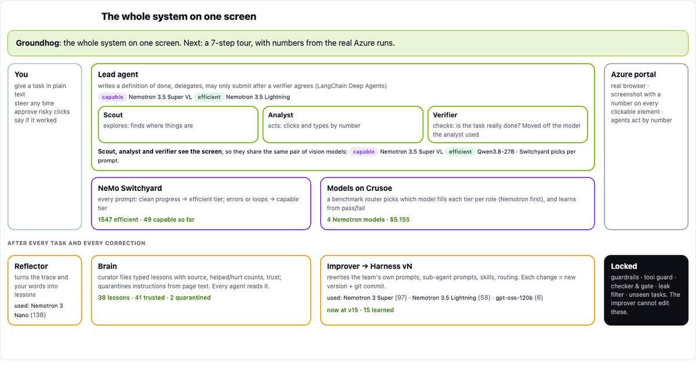
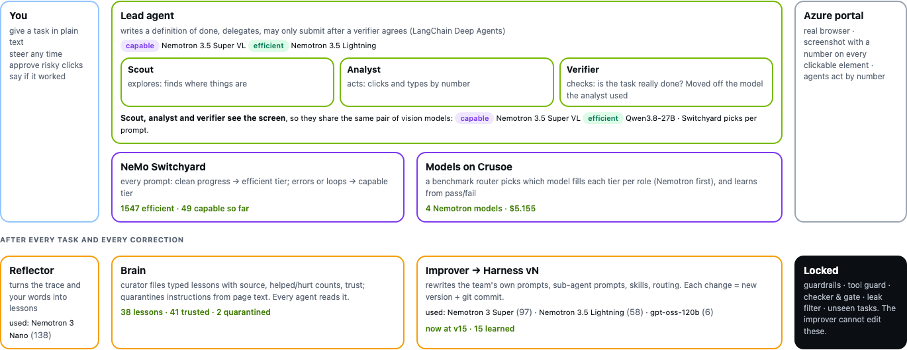

# Groundhog: a computer-use agent team that learns Azure while it works

An NVIDIA Nemotron agent team on Crusoe that operates the **real Azure portal** from screenshots and text, and gets
better at it as it goes. It accumulates **knowledge** (a curated brain), **grows its own harness** (new skills, new
specialist sub-agents, prompt and routing edits, each a git-committed version) and **adapts in the middle of a task**,
driven only by the user's request and the team's own interaction, with no human feedback needed.

Problem statements: **Version N+1** (harness evolution) · **Shared Brain** (curated playbook) · **Done Means Done**
(verifier-gated submit).



*The architecture: an overview, then seven steps (5 s each), with live numbers from the Azure runs. Interactive version: run the demo
app (`GROUNDHOG_WORLD=azure python -m groundhog.app`) and open the **Architecture** tab.*

## How it works




| layer | what | adapts from |
|---|---|---|
| **Team** (LangChain Deep Agents) | lead → `scout`, `analyst-<job>`, `verifier-<job>` + specialist sub-agents the improver creates | |
| **Screen** | Playwright Chromium; screenshot with numbered marks on every element (Set-of-Marks); act by number | |
| **NeMo Switchyard** | embedded `stage_router`: every prompt → capable or efficient model from the agent's tool activity | each prompt |
| **Adaptive router** | which models fill the tiers per job: published benchmarks (WebVoyager, OSWorld, OCRBench, τ-bench, IFBench) + measured success | every task outcome |
| **Brain** | curated lessons (reflector → single curator: dedup, quarantine, trust, retire), in every agent's prompt | mid-task + after tasks |
| **Harness** `harness_azure/vN/` | prompts, sub-agents (`subagents.yaml`, incl. `specialists`), skills (`skills/*/SKILL.md`), routing, Deep Agents profile | mid-task + after batches |
| **Guardrails** `frozen/`, tools | destructive/submitting clicks need human approval (denied unattended), no passwords, Azure URLs only | nobody |

**Mid-task adaptation (no feedback):** the lead's middleware reports what happens inside a running task (a sub-agent
returns, a guard trips, a model escalates, an unverified submit is blocked, the user steers). A background learner turns
it into brain lessons the running agents read at their next model call, and on trouble asks the improver for one
harness edit applied immediately; new skills are injected into the running task's prompts. After a batch, the team also
learns from outcomes **it judged itself** (verifier-confirmed submit); the grader is used only to report results.

### Version N+1: every update is a new harness version

The team does not wait for a batch of tasks to improve. Each time something happens that the improver can learn from,
it writes **one** edit (a new skill, a new specialist sub-agent, or a prompt / routing change) with a stated hypothesis,
and it becomes **harness v(N+1) immediately**, as a git commit with its diff in `runs_azure/archive.jsonl`.
On Oct 17 the Azure harness went from **v0 to v15**:

| what triggered the new version | versions |
|---|---|
| a submit was rejected mid-task (the verifier said "not done") | 5 |
| the router escalated mid-task (the agent was looping) | 4 |
| a guard tripped mid-task (step cap, repeated actions) | 2 |
| a message from the user, live | 2 |
| outcomes of a training batch, judged by the team's own verifier | 1 |
| human-curated cleanup of v1–v8 | 1 |

Most edits are new procedure skills (`skills/azure-*-procedure/SKILL.md`, e.g. the storage-account wizard or verifying
a list page), plus lead-prompt edits and new specialist sub-agents in `subagents.yaml`. For unattended runs,
`groundhog/evolve.py` adds a promotion gate (+2 solved on held-out tasks, 100% security tests, leak filter).

### Shared Brain: a curated playbook, not a notes file

`runs_azure/brain.db` stores each lesson with its **type** (fact, pitfall, recipe, check), **scope**, **source task**,
**helped / hurt counters** and **trusted / quarantined / retired** flags, and renders them as `BRAIN.md` at the end of
every agent's prompt in a stable order. A reflector proposes add / update / retire changes citing trace steps; a single
curator applies them from a queue, so parallel agents never conflict. The curator merges near-duplicates, retires a lesson
when hurt ≥ helped + 2, marks it trusted only after a later task that used it passes, and quarantines lessons derived
from page text that contain instructions or URLs (2 quarantined so far).

## Models (Crusoe)

All five NVIDIA models served on Crusoe are the default for every role: **Nemotron 3.5 Super VL** and **Nemotron 3 Nano
Omni** (screen), **Nemotron 3 Super**, **Nemotron 3.5 Lightning**, **Nemotron 3 Nano** (planning, reflection,
improvement). One or two alternatives per category fill Switchyard's other tier: Qwen3.8-27B and Gemma-4-31B (vision),
gpt-oss-120b (text).

## Experiment

14 real Azure tasks, 8 long-tail (multi-tab creation wizards filled without submitting, multi-blade read tours, >20
screen actions). **10 training** tasks in 2 batches of 5 (4 long-tail); **4 hard held-out** long-tail tasks evaluated
after **0, 5 and 10** training tasks on a frozen snapshot (harness version, brain and router fixed during the round),
in parallel headless browsers sharing the human's sign-in. Metrics per held-out task: solved (graded on the final
browser state), self-assessed done, screen actions, model calls, tokens, cost, seconds, sub-agent delegations, scout
and specialist use, guards, escalations, fallbacks, tool errors, blocked submits, Switchyard capable/efficient, models,
final screenshot.

```bash
python3 -m venv --system-site-packages .venv && .venv/bin/pip install -r requirements.txt
.venv/bin/python -m playwright install chromium
echo "LLM_API_KEY=<Crusoe key>" > .env
.venv/bin/python -m groundhog.app            # http://localhost:7860 · "Open Azure portal" → sign in yourself
GROUNDHOG_BROWSERS=10 .venv/bin/python -m groundhog.experiment   # unattended experiment (Results tab updates live)
```

The app: **Architecture** (live system diagram + guided tour), **Live demo** (chat, steer any time, approve risky clicks, 👍/👎 optional), **Harness
versions** (timeline + diffs), **Model routing**, **Knowledge**, **Results** (quantitative and qualitative).

## Results

See the **Results** tab (source: `runs_azure/experiment.jsonl`, `midtask.jsonl`, `archive.jsonl`, `brain.db`,
`routing.jsonl`). Small samples (4 held-out tasks per evaluation): read changes as trends.

All numbers below are from real runs on the Azure portal on Oct 17, 2026.

### Highlights

- **Learns from a single correction.** "Open the list of storage accounts" failed on harness v2 (it asked to log in
  while already signed in). One sentence of feedback produced **v3** (`lead_prompt.md`: check the signed-in state first),
  and the same task **passed two minutes later** (19 steps, $0.014).
- **Can't declare victory early.** On a 10-step "create a resource group" task the lead tried to submit twice; both were
  refused until a verifier on a different model confirmed the screen (`traces/live/live-1792274534.json`).
- **Guardrails held.** 40 actions were blocked and logged (`runs_azure/denials.jsonl`): 36 risky clicks without human
  approval, 2 attempts to type into password fields, 2 improver reads outside its allow-list.
- **Rewrites itself without supervision.** In the unattended experiment the team wrote 8 harness versions on its own,
  mostly new procedure skills created mid-task when a guard tripped, a submit was rejected or the router escalated.
- **Cost-aware routing.** Switchyard sent **1,017** prompts to the efficient tier and **41** to the capable tier.
  Nemotron models do most of the work, alongside Qwen3.8-27B and gpt-oss-120b, all on Crusoe; **$3.81** in total.

### Unattended continual-learning experiment (`groundhog.experiment`)

Two training batches of 5 tasks; 4 hard long-tail held-out tasks (`webapp_wizard`, `vnet_wizard`, `keyvault_wizard`,
`entra_tour`) evaluated on a frozen snapshot after 0, 5 and 10 training tasks.

| after N training tasks | harness | skills | brain lessons | held-out solved (n = 4) | $ per held-out run |
|---|---|---|---|---|---|
| 0 | v0 | 1 | 0 | 1 / 4 | 0.29 |
| 5 | v2 | 3 | 17 | 1 / 4 | 0.31 |
| 10 | v8 | 9 | 132 | 0 / 4 | 0.54 |

Training batches: **4 / 5** (batch 1, v0) and **3 / 5** (batch 2, v2).

**Next steps from this run:** route every self-written edit through the held-out gate before it is applied (the gate in
`evolve.py` promotes a version only for +2 solved, or +1 at lower cost), prune skills that are never used to keep prompts
lean, and evaluate on a larger held-out set than n = 4.

## Disclosed

- Only Azure is real; no resources are created (wizards stop at Review + create; Create needs human approval).
- Switchyard is the official `nemo_switchyard` 0.3.0 wheel embedded in-process (no separate server).
- Sandbox: Docker for agent code, Playwright allow-list for the browser; OpenShell policy in `sandbox/policy.yaml` is the target.
- Your Azure session export (`runs_azure/auth_state.json`) and browser profile are git-ignored; never commit them.
